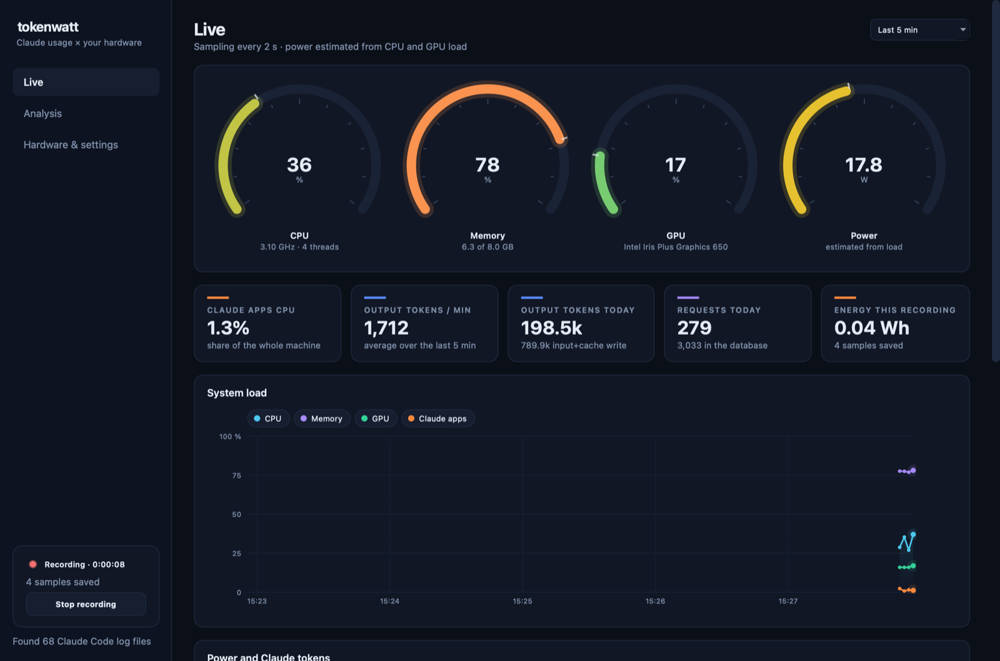
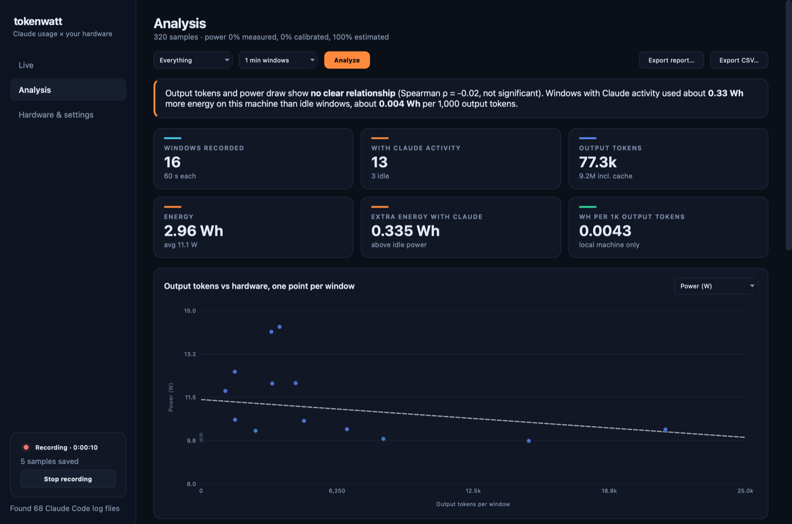

# tokenwatt

Does using Claude actually make my laptop work harder? How much extra power does a heavy coding session pull, and does it line up with the number of tokens going back and forth?

tokenwatt answers that for your own machine. It records CPU, RAM, GPU and power draw in the background, reads the token counts Claude Code already writes to disk, lines the two up minute by minute and tells you how strongly they move together.

It comes as a desktop app for Mac and Windows and as a command-line tool. Everything stays local. No accounts, no API keys, nothing is uploaded.



## Download the app

Grab the latest version from the [Releases page](https://github.com/ianjacobo2009-hub/tokenwatt/releases/latest):

| Computer | File |
|---|---|
| Mac with Apple Silicon (M1 and newer) | `tokenwatt-macOS-AppleSilicon.zip` |
| Mac with Intel | `tokenwatt-macOS-Intel.zip` |
| Windows 10 / 11 | `tokenwatt-Windows.zip` |

**Mac:** unzip and drag `tokenwatt.app` into Applications. The app isn't signed with a paid Apple developer certificate, so macOS asks once: on macOS 12–14 right-click the app and choose **Open**; on macOS 15 and newer open it once, then go to **System Settings → Privacy & Security** and click **Open Anyway**.
**Windows:** unzip anywhere and run `tokenwatt.exe` inside the folder. If SmartScreen appears, click **More info → Run anyway**.

No Python needed. macOS 12 or newer, Windows 10 or newer.

## What the app does

**Live.** Gauges for CPU, memory, GPU and power that ease to each new reading and change colour with load, with a marker for the recent peak. Below them, scrolling charts of system load and power with Claude's output tokens as bars. Every reading is a point you can hover for exact values, and the legend chips switch series on and off. A feed shows your latest Claude requests as they happen.

**Recording.** One button saves the readings so they can be analysed later. It can start when the app opens and keep going from the menu bar (Mac) or system tray (Windows) when you close the window.

**Analysis.** Pick a time range and a window size and it works out:

- a **correlation matrix**: output tokens, total tokens, uncached tokens and request count against power, CPU, Claude's own CPU share, RAM and GPU. Spearman and Pearson, with p-values corrected for the fact that neighbouring minutes look alike
- **with Claude vs without**: average power, CPU and so on in windows with and without Claude activity, with a Welch t-test
- **marginal energy**: Wh per 1,000 output tokens, per million tokens and per request on your hardware, with 95% confidence intervals
- a scatter plot with one point per window (hover any of them), and an exportable HTML report and CSV



**Hardware & settings.** What it detected (CPU, cores, clock, rated power, RAM, GPU, battery), how power is measured on your machine, the sample rate, and where your data lives.

## Command line

The same engine is also a command-line tool, handy for servers or for leaving it running over SSH. It needs Python 3.9 or newer.

```bash
pip install git+https://github.com/ianjacobo2009-hub/tokenwatt
```

or from a clone:

```bash
git clone https://github.com/ianjacobo2009-hub/tokenwatt
cd tokenwatt
pip install .            # command line only
pip install ".[app]"     # plus the desktop app: run `tokenwatt app`
```

The app and the command line share one database, so you can record with either and analyse with the other.

### Commands

```bash
tokenwatt specs                 # what hardware it found
tokenwatt record                # leave this running while you work (Ctrl+C to stop)
tokenwatt analyze               # quick summary in the terminal
tokenwatt report --open         # full report in your browser
```

Record for at least an hour that mixes Claude work with other work or idle time. The more contrast, the clearer the answer.

More options:

```bash
tokenwatt record -i 2 -d 3600          # sample every 2 s for an hour
tokenwatt record --tdp 45              # if the CPU power guess in `specs` is wrong
tokenwatt analyze --since 24h -w 120   # last day, 2-minute windows
tokenwatt analyze --json > result.json
tokenwatt export -o windows.csv        # one row per window, for Excel or pandas
tokenwatt import --csv usage.csv       # API usage export instead of Claude Code logs
tokenwatt status                       # what's stored so far
```

The data lives in `~/.tokenwatt/tokenwatt.db` (SQLite). Set `TOKENWATT_DB` or pass `--db` to use another file.

### Run the command line in the background

macOS / Linux:

```bash
nohup tokenwatt record -q > /dev/null 2>&1 &
```

Windows (PowerShell):

```powershell
Start-Process -WindowStyle Hidden tokenwatt -ArgumentList "record","-q"
```

## Where the numbers come from

**Tokens.** Claude Code logs every response to `~/.claude/projects/**/*.jsonl` with input, output, cache-write and cache-read counts. tokenwatt reads those (including subagent logs), removes the duplicate lines written while a response streams, and only re-reads files that changed. `CLAUDE_CONFIG_DIR` is respected. Usage on the claude.ai website isn't stored on your computer, so it can't be counted unless you import a CSV with `timestamp`, `input_tokens` and `output_tokens` columns.

**CPU, RAM.** [psutil](https://github.com/giampaolo/psutil). "Claude apps CPU" adds up processes whose name or command line contains `claude` (the desktop app and the Claude Code CLI), scaled to the whole machine.

**GPU.** `nvidia-smi` for NVIDIA cards, `ioreg` on macOS (Intel and Apple Silicon), `gpu_busy_percent` for AMD on Linux.

**Power**, best source first:

| Platform | Measured | Notes |
|---|---|---|
| macOS laptop on battery | whole system, from the battery's voltage and current | no admin rights needed |
| Linux laptop on battery | whole system, from `/sys/class/power_supply` | |
| Linux desktop | CPU package via Intel RAPL, plus NVIDIA draw | RAPL is often root-only: `sudo chmod o+r /sys/class/powercap/intel-rapl:*/energy_uj` |
| Anything else | estimated | from CPU/GPU load and the CPU's rated power |

If some of your samples are measured (say you unplugged for 20 minutes) tokenwatt fits a power model to them and uses it for the plugged-in time, which is much better than the generic estimate. The report says which kind of number you're looking at.

## Reading the results honestly

- Claude itself runs in Anthropic's datacenters. tokenwatt measures what **your** computer spends around it: the terminal or app, network, rendering, the tools Claude Code runs on your machine. That's usually small, and that's a valid finding.
- If you want a rough idea of datacenter energy too, pass your own assumption with `--remote-wh-per-1k`. Anthropic doesn't publish a per-token figure, so the report labels it as a what-if.
- Correlation isn't causation. Compiling, tests or a video call during a Claude session will also push power up. The "Claude apps CPU" column helps separate them.

## Development

```bash
python -m venv .venv && source .venv/bin/activate
pip install -e ".[app,dev]"
pytest
pyinstaller --noconfirm tokenwatt.spec   # builds the desktop app into dist/
```

The command line only needs psutil; the app adds PySide6 (Qt). The charts and gauges are drawn by hand with QPainter. The statistics (rank correlation, t-distribution p-values, regression) are implemented in `src/tokenwatt/stats.py` and checked against textbook values in the tests.

## License

MIT
